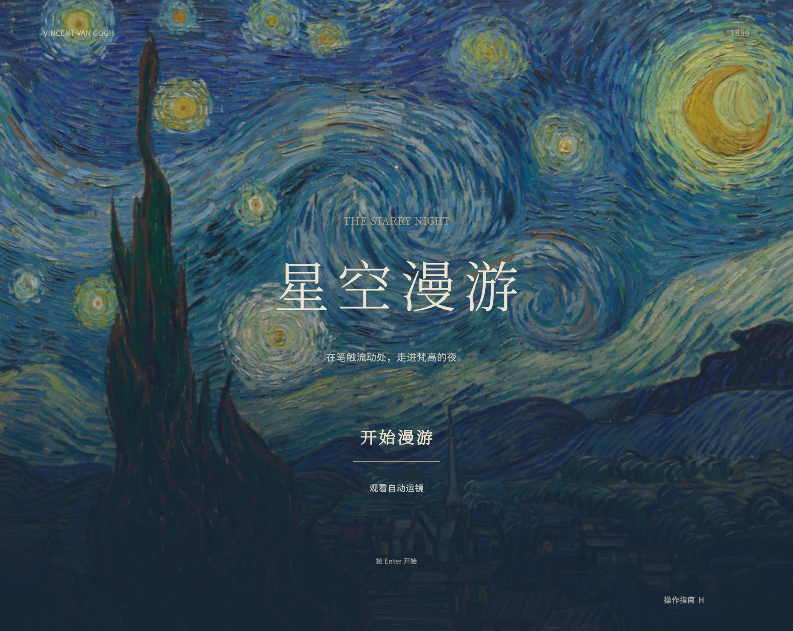

<p align="center">
  
</p>
<h1 align="center">星空漫游 · Starry Night Roaming</h1>
<p align="center"><strong>把梵高的笔触，变成可以穿行的三维世界。</strong></p>
<p align="center">Unity 6 · 三维网格笔触 · 自由漫游 · 电影运镜</p>
<p align="center">
  <a href="#观看展示">观看展示</a> ·
  <a href="#开始体验">开始体验</a> ·
  <a href="#设计思路">设计思路</a> ·
  <a href="#视觉实现">视觉实现</a> ·
  <a href="#开发与项目结构">开发说明</a>
</p>

<p align="center">
  
</p>

《星空漫游》是一款以梵高《星空》为灵感的单人艺术漫游作品。场景与程序代码由人工智能生成，并根据视觉反馈持续调整优化。进入画面后，可以沿着柏树旁的小路走进村庄，经过教堂、农舍与麦田，也可以升到空中，从不同角度观察星光和旋涡之间的空间层次。

它把观赏和探索作为主要体验：没有任务、战斗、计分或拖放物品。你可以自由选择视角，也可以让自动运镜带你游览。

## 观看展示

### 从柏树走进星夜 · 29 秒

沿小路穿越城镇，环绕展示星空，最后停留在金色麦田。

<div align="center">
  <video src="https://github.com/user-attachments/assets/0b441fa4-cb43-4495-96bd-9b2e1cbb64de" controls width="800"></video>
</div>
<p align="center"><a href="https://github.com/Hao2048/starry-night-roaming/raw/refs/heads/main/Documentation/media/roaming-29s.mp4?download=1">下载高清漫游视频 · 29 秒</a></p>

### 在笔触之间穿梭 · 前 4 秒

深入星空区域，观察近处笔触与远处星光的视差。这一段只保留独立穿梭视频的前 4 秒。

<div align="center">
  <video src="https://github.com/user-attachments/assets/1f7bcc88-369a-4c0c-bb5c-2a6d04b15dda" controls width="800"></video>
</div>
<p align="center"><a href="https://github.com/Hao2048/starry-night-roaming/raw/refs/heads/main/Documentation/media/sky-flight-4s.mp4?download=1">下载高清穿梭视频 · 4 秒</a></p>

> 视频使用项目中实际三维场景的相机画面，按固定时间逐帧采集，隐藏了操作界面。视频输出帧率为 30 fps，不代表实时性能测试结果。

## 开始体验

1. 安装 **Unity Hub**，添加 **Unity 6.6 / 6000.6.0f1**。
2. 克隆本仓库，在 Unity Hub 中选择 **Add project from disk**，添加仓库根目录。
3. 等待 Unity 恢复包依赖、导入资源。
4. 打开 `Assets/StarryStudy/StarryNightPreview.unity`，点击 **Play**。
5. 在开始界面点击 **开始漫游**，或按 **Enter**。选择 **观看自动运镜** 可在进入场景后跟随镜头游览。

```bash
git clone https://github.com/Hao2048/starry-night-roaming.git
```

仓库包含当前场景已生成的网格资源，打开后即可运行，无需先执行美术重建脚本。场景面片数量较多，首次导入和着色器编译需要等待；建议使用独立显卡或较新的 Apple Silicon 设备。已在 macOS / Metal 下验证，Windows 和 Linux 尚未做发行验证。

### 操作方式

<div align="center">
  <table>
    <thead><tr><th align="center">操作</th><th align="center">按键</th></tr></thead>
    <tbody>
      <tr><td align="center">前后左右移动</td><td align="center">W / A / S / D</td></tr>
      <tr><td align="center">转动视角</td><td align="center">按住鼠标右键拖动</td></tr>
      <tr><td align="center">降低 / 升高</td><td align="center">Q / E</td></tr>
      <tr><td align="center">加速移动</td><td align="center">Shift</td></tr>
      <tr><td align="center">回到起始机位</td><td align="center">R</td></tr>
      <tr><td align="center">开始 / 停止自动运镜</td><td align="center">T</td></tr>
      <tr><td align="center">暂停 / 继续自动运镜</td><td align="center">P</td></tr>
      <tr><td align="center">重播原画入场过渡</td><td align="center">O</td></tr>
      <tr><td align="center">开关轻微笔触流动</td><td align="center">F</td></tr>
      <tr><td align="center">隐藏 / 显示漫游界面</td><td align="center">F10</td></tr>
      <tr><td align="center">查看操作指南</td><td align="center">H</td></tr>
      <tr><td align="center">暂停 / 继续</td><td align="center">Esc</td></tr>
    </tbody>
  </table>
</div>

暂停菜单可返回开始界面。自由漫游支持升降，更适合用鼠标和键盘探索；内置自动运镜路线约 80 秒。

## 设计思路

### 从“看一幅画”到“走进笔触”

起始构图以《星空》的柏树、村庄、山脊、旋涡和月亮为视觉参照。进入后，镜头可以离开原来的观察位置，用视差揭示前景、中景和远景。为了让漫游成立，画作之外的地面、村路、农舍、植物和麦田进行了空间延展，布局允许与原作有所不同。

### 用统一的笔触语言组织整个世界

星空、建筑、树木、山体和地面都由大量独立、短小的三维网格笔触组成。通过大小、方向、颜色、疏密和深度的变化，让面片聚合为物体，又在边缘适度散开。房屋保留可辨认的屋顶、墙面和窗光，但与天空使用同一套笔触表达。

### 让道路连接观看与行走

柏树是初始机位的空间锚点。小路连接树旁高地、村庄街道与远处山脚；建筑分布在道路两侧，外围用植物、农舍和麦田补充。自动运镜和自由探索共用同一场景，方便观赏和录制。

## 视觉实现

- **真实三维网格笔触**：每段笔触具有独立几何形态和厚度，不用整幅原画作为漫游背景。
- **贴合画面的方向排列**：编辑器离线分析参考图的局部笔触方向，再结合旋涡、星团和物体区域的引导安排笔触。
- **按物体安排空间深度**：柏树、房屋、山脊、旋流和月亮使用不同的空间位置与体积层次，避免把所有内容堆在同一深度。
- **顶点色与自定义着色器**：以顶点颜色保留蓝、青、黄的色彩关系，使用轻微表面明暗和笔触起伏，保留油画感。
- **连续的小幅流动**：笔触沿既定方向做有界位移，已移除生命周期重置和噪点溶解，避免局部反复消失、渐显。
- **外围渐疏**：地面外缘通过笔触密度、尺寸和颜色的变化过渡，录制时仍建议在主要艺术场景区域内取景。
- **原画与场景交接**：原画图像用于开始界面与入场过渡；过渡结束后显示的是实时三维网格场景。

项目借鉴了高斯泼溅“以大量小单元组织空间”的表达思路，实际渲染使用 Unity 网格与顶点色，**不包含 3D Gaussian Splatting 的训练、推理或点云重建管线**。

## 开发与项目结构

主要技术：Unity 6.6、URP 17.6、Input System、uGUI / TextMeshPro、自定义 Shader。

```text
Assets/
  ArtWalk/Scripts/PaintMesh.cs       # 共用的程序网格笔触工具
  StarryStudy/
    StarryNightPreview.unity        # 唯一运行场景
    StarryStudyController.cs        # 移动、观察、运镜控制
    StarryCinematicTour.cs          # 镜头路径采样
    StarryPaintingTransition.cs     # 原画到场景的过渡
    StarryWorldLayout.cs            # 地形高度、世界布局
    UI/                            # 开始界面、暂停、指南、字体
    Shaders/                       # 笔触、环境、封面与转场
    Editor/                        # 离线生成与美术调整工具
    FittedMeshes/                  # 场景使用的构图笔触网格
    PainterlyTownMeshes/           # 城镇、道路、麦田与山体网格
Documentation/media/                        # README 图标、截图与视频
Packages/                          # Unity 包依赖
ProjectSettings/                   # 工程设置
```

### 调整与构建

- **调整视觉**：在场景中编辑相机、对象位置和材质；`Starry Study` 菜单提供各部分生成工具。
- **重新生成**：编辑器工具会重建相应美术对象，可能覆盖手工调整。建议先提交自己的修改，再按需执行；正常游玩无需重建。
- **重算参考笔触**：`Assets/StarryStudy/Editor/Reference/prepare_strokes.py` 使用 Pillow、NumPy 等 Python 依赖，仅用于离线工具流程。
- **打包 macOS**：调用 `StarryStudy.StarryStudyBuilder.BuildPlayer()`，输出到 `Builds/StarryNight/StarryNight.app`；也可通过 Unity 的 Build Profiles 打包当前场景。
- **其他平台**：在 Build Profiles 中添加目标平台并只勾选 `StarryNightPreview.unity`，需要自行验证图形和输入表现。

工程采用混合序列化：大型网格以 Unity 原生二进制格式存储，场景和脚本保留可读文本。缓存、构建产物、录制中间帧、旧画作和无引用的实验资源不进入版本管理。

## 素材与许可

项目代码及原创程序生成资源使用 [MIT License](LICENSE)。梵高画作、Noto 字体、Unity 与 TextMeshPro 资源各自适用其原有许可，详情见 [第三方素材说明](THIRD_PARTY_NOTICES.md)。

本作品是对《星空》的互动视觉实验，与梵高相关机构或博物馆没有隶属或背书关系。
